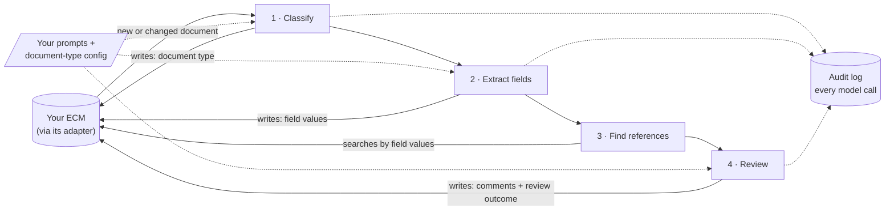

# open-doc-review

Advisory AI document review that bolts onto the content-management system (ECM) you already use.

When a document lands in your ECM, open-doc-review:

1. **classifies** it into one of the document types you define, and saves the type as metadata,
2. **extracts** the fields you define for that type into metadata,
3. **finds the reference documents** it must agree with (by matching extracted fields: an invoice's
   PO number finds the purchase order),
4. **reviews** it against those references with Claude, using **your** prompts, and
5. **writes the findings beside the document**: one comment per finding (severity, page, what was
   compared), a summary comment, and review metadata.

A reference that arrives later triggers a re-review, and long PDFs are reviewed in page windows.

> **Align it with your own policies.** The example document types, fields, prompts and severity levels
> are starting points, not a standard. Before relying on any result, make them reflect your organization's
> own policies, procedures, specifications and regulatory obligations; have the policy owners approve the
> wording; and check the results with `docreview eval`. Every starter prompt carries this notice in its
> header. Nothing in this project is legal, quality or regulatory advice.

It never edits, moves, renames or deletes a document. The ECM port has no method that could. Every
finding is advisory: a person decides what to do with it.



Each step writes its own result into the ECM as soon as it has it. The document type and fields are
therefore searchable (and correctable by a person) before the review runs, and a person's correction is
respected on the next pass.

## What you bring

| You provide | Where | Example |
|---|---|---|
| Document types and their fields | `docreview.yaml` → `doc_types` | invoice: `invoice_number`, `po_number`, `total` |
| How to find references | `doc_types.<type>.review.references` | invoice → purchase order where `po_number` matches |
| Prompts, in your own words and style | a folder of Markdown files | `prompts/review/invoice.md`, started from `examples/prompt_templates/review_template.md` |
| Documents with known problems, to check it works | `expected.yaml` + a test folder | `examples/generic/expected.yaml` |
| A connection to your ECM | an adapter: `local`, `box`, or your own | see [docs/ADAPTERS.md](docs/ADAPTERS.md) |

What's in `examples/`:

| Folder | What it is |
|---|---|
| `shared_prompts/` | Generic starter system, classification and extraction prompts, written for any document type. |
| `prompt_templates/` | A fill-in review prompt template: checks, exclusions, severity, how to report. |
| `generic/` | The quick-start example: an invoice checked against a purchase order, and a batch record against its master record. |
| `starter_pack/` | Ready-to-copy examples: three-way invoice match, certificate of analysis against a specification, contract against standard terms, and a policy checklist with no references. |

All of it is illustrative. Copy it, then replace the wording with your own.

## Quick start (no ECM needed)

```bash
git clone https://github.com/enveda/open-doc-review.git && cd open-doc-review
uv sync                                   # or: pip install -e .
export ANTHROPIC_API_KEY=...              # or: ant auth login
cd examples/generic
uv run docreview check                    # validates config, prompts and the adapter
uv run docreview templates                # shows the metadata it will write (for Box/SharePoint: the setup script)
uv run docreview run --once               # reviews the sample documents in library/
uv run docreview estimate                 # rough tokens and cost before you run anything (no model calls)
uv run docreview eval --runs 3            # scores the review against the planted problems (expected.yaml)
```

### What you'll see

The example library holds two made-up pairs of documents. Each document under review has four planted
mistakes, so you can check that the review catches them.

**A supplier invoice** (`library/inbox/INV-2041.txt`), checked against the purchase order it cites
(`library/purchase_orders/PO-7730.txt`):

1. It bills 550 widgets; the PO ordered 500.
2. Brackets are charged at 0.95; the agreed price is 0.85.
3. It adds a 60.00 expedite fee that is not on the PO.
4. The total says 1,460.00; the lines add up to 1,450.00.

**An executed batch record** (`library/inbox/EBR-B24-0117.txt`), checked against the master batch record it
was made to (`library/master_batch_records/MBR-0042.txt`), found by MBR number and version:

1. 10.40 kg of active ingredient was dispensed; the limit is 10.00 kg ± 1% (10.10 kg at most).
2. The drying inlet air was 68 °C; the limit is 55–65 °C.
3. The blend step has no second-person verification, which the MBR requires.
4. The yield is 91.2%; the acceptable range is 95.0–102.0%.

None of the out-of-limit results has a deviation recorded. Nothing in these files refers to a real product,
company or batch.

The local adapter has no ECM to write to, so after the run it saves results **in a new file next to each
document**, such as `INV-2041.txt.docreview.json`. (With Box or SharePoint, the same results appear as metadata
and comments on the file.) This file does not exist until you run the example. Trimmed, it looks like this;
the wording of the findings varies from run to run:

```json
{
  "classification": {"doc_type": "invoice", "processed_version": "3f9c0d1e2a7b", "...": "..."},
  "fields": {"invoice_number": "INV-2041", "po_number": "PO-7730", "supplier": "Acme Widgets Co.",
             "invoice_date": "2026-09-18", "total": 1460.0, "currency": "USD"},
  "review": {"outcome": "blocking_findings",
             "finding_counts": {"blocker": 1, "major": 3, "minor": 0, "info": 0},
             "references": {"Purchase order": "purchase_orders/PO-7730.txt"}, "...": "..."},
  "comments": [
    {"text": "[BLOCKER] Invoice total does not add up\nLines sum to 1,450.00 but the total states 1,460.00."},
    {"text": "[MAJOR] Quantity exceeds purchase order\nLine 1 bills 550; PO-7730 ordered 500. · compared with Purchase order"},
    {"text": "[MAJOR] Unit price differs from purchase order\nBracket billed at 0.95; agreed price 0.85. · compared with Purchase order"},
    {"text": "[MAJOR] Charge not on purchase order\nExpedite fee of 60.00 is not on PO-7730. · compared with Purchase order"},
    {"text": "Review summary — advisory outcome: blocking findings\n..."}
  ]
}
```

- **classification**: what type of document it decided this is.
- **fields**: the values it pulled out, as configured for that type in `docreview.yaml`.
- **review**: the overall outcome, the count of findings by severity, and which reference documents were used.
- **comments**: one per finding (severity, what's wrong, what it was compared with), plus a summary.

Every call to the model is also recorded in `logs/ai_calls.jsonl`, the audit log: what was asked,
which model answered, what it returned, tokens and time.

Other commands:

```bash
docreview run                    # poll forever (every 60 s; --interval to change)
docreview process <document-id>  # one document: classify, extract, review if not yet reviewed
docreview review <document-id>   # review now, even if this version was already reviewed
```

Set `review.dry_run: true` to run real model calls while writing nothing to the ECM. It's useful
for trying a prompt change on live documents.

## Connecting your ECM

| Adapter | `adapter:` | Install | Status | Guide |
|---|---|---|---|---|
| Local folder | `local` | (built in) | supported: for trying it out and tests | this README |
| Box | `box` | `pip install 'open-doc-review[box]'` | supported | [docs/BOX.md](docs/BOX.md) |
| SharePoint Online | `sharepoint` | `pip install 'open-doc-review[sharepoint]'` | experimental | [docs/SHAREPOINT.md](docs/SHAREPOINT.md) |
| Veeva Vault | `veeva_vault` | `pip install 'open-doc-review[veeva_vault]'` | example | [docs/VEEVA_VAULT.md](docs/VEEVA_VAULT.md) |
| M-Files | `mfiles` | `pip install 'open-doc-review[mfiles]'` | example | [docs/MFILES.md](docs/MFILES.md) |
| Alfresco | `alfresco` | `pip install 'open-doc-review[alfresco]'` | example | [docs/ALFRESCO.md](docs/ALFRESCO.md) |
| Amazon S3 | `s3` | `pip install 'open-doc-review[s3]'` | example | [docs/S3.md](docs/S3.md) |

What the statuses mean:

- **Supported:** built and unit-tested against the vendor's SDK.
- **Experimental:** written to the documented API and unit-tested, but not yet run against a live system.
- **Example:** the same as experimental, but intended mainly as a worked starting point for your own adapter. Read its Known limits first.

**Anything else** (OpenText, Documentum, NetDocuments, Egnyte, Google Drive, ...): implement eight methods. See
[docs/ADAPTERS.md](docs/ADAPTERS.md). `adapter: your_package.module:YourAdapter` loads it, with no fork needed.

## Documentation

- [docs/ARCHITECTURE.md](docs/ARCHITECTURE.md): how a document flows through, and the design rules
- [docs/CONFIGURATION.md](docs/CONFIGURATION.md): every config key
- [docs/METADATA.md](docs/METADATA.md): every metadata key written on a document, with examples, and how each ECM stores it
- [docs/PROMPTS.md](docs/PROMPTS.md): writing your own prompts, and the variables available
- [docs/WRITING_REVIEW_PROMPTS.md](docs/WRITING_REVIEW_PROMPTS.md): how to write review checks and severities that give consistent results
- [docs/VALIDATION.md](docs/VALIDATION.md): a generic risk-assessment and validation starting point for regulated organizations
- [docs/ADAPTERS.md](docs/ADAPTERS.md): writing an adapter for your ECM
- [docs/BOX.md](docs/BOX.md): setting up the Box adapter
- [docs/SHAREPOINT.md](docs/SHAREPOINT.md): setting up the SharePoint adapter (experimental)
- Example adapters: [Veeva Vault](docs/VEEVA_VAULT.md), [M-Files](docs/MFILES.md), [Alfresco](docs/ALFRESCO.md), [Amazon S3](docs/S3.md)
- [docs/DEPLOY.md](docs/DEPLOY.md): running it as a service, rolling it out, cost

## Before you use it on real documents

- Documents are sent to the Claude API. Check that this is allowed for your content, and review
  your data-retention settings with Anthropic.
- Give the adapter's service account the least access that works: read, plus write for metadata and comments.
- Findings come from a model. Validate the prompts and configuration on documents with known
  problems before anyone relies on the output, and keep a person in the loop.

## Author

Created and maintained by Andrew Martin ([LinkedIn](https://www.linkedin.com/in/andrew-martin-7961834b/), [GitHub](https://github.com/Hedgehog-Info)) at Enveda.

## License

MIT License. See [LICENSE](LICENSE).
